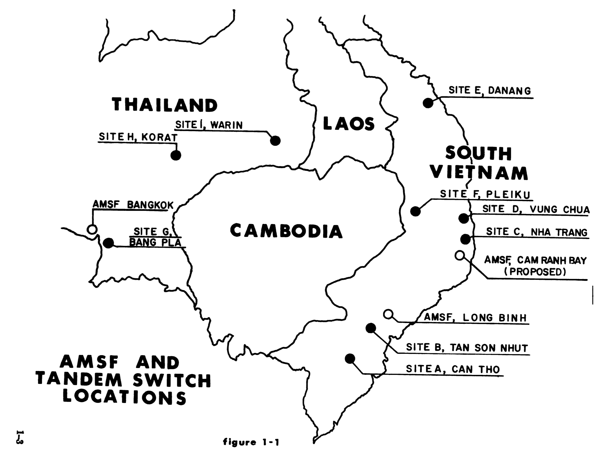
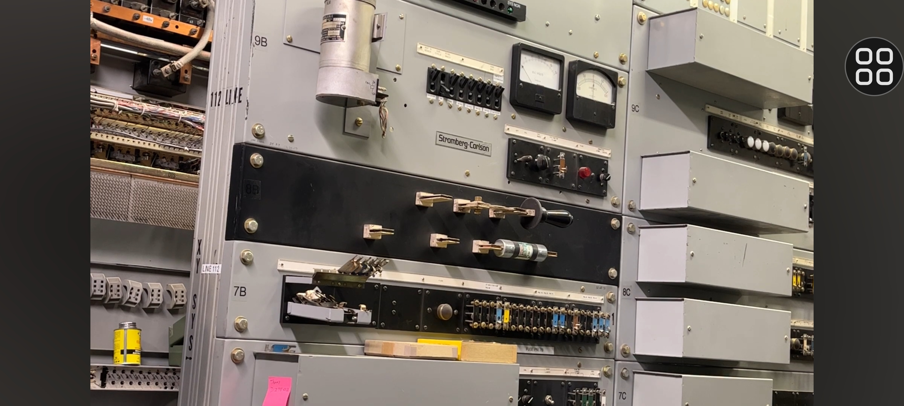

# /**
# * Tiêu đề : "Những tiếng chuông của Tổ quốc thân yêu."
# *
# * @copyright Copyright (c) 2026, Hoàng Hải <leduchoanghai@yahoo.com>
# * @license   MIT, http://www.opensource.org/licenses/mit-license.php
# */

Sự tham gia của các lực lượng quân sự Hoa Kỳ tại Việt Nam bắt đầu từ ngày 23 tháng 12 năm 1950, khi Hoa Kỳ ký một hiệp định năm bên với Pháp, Việt Nam, Campuchia và Lào. Hiệp định này cung cấp viện trợ quân sự gián tiếp của Hoa Kỳ cho các quốc gia nêu trên, đồng thời thiết lập một Nhóm Cố vấn Viện trợ Quân sự Hoa Kỳ (MAAG) tại Sài Gòn. Trong những năm đầu thập niên 1950, các lực lượng Việt Minh đã giành quyền kiểm soát miền Bắc; khu vực này sau đó bị tách khỏi miền Nam tại ranh giới gần vĩ tuyến 17 vào ngày 26 tháng 12 năm 1953. Ngày 7 tháng 5 năm 1954, Điện Biên Phủ thất thủ, và không lâu sau đó, các lực lượng Pháp đã rút khỏi Việt Nam. Tiếp đó, khi áp lực gia tăng trên khắp khu vực Đông Nam Á, Hoa Kỳ đã liên tục mở rộng các hoạt động cố vấn nhằm hỗ trợ các lực lượng vũ trang của Việt Nam Cộng hòa. Vào tháng 2 năm 1962, tổ chức MAAG tại Việt Nam – vốn đang ngày càng lớn mạnh – đã được chuyển đổi thành Bộ Chỉ huy Viện trợ Quân sự Hoa Kỳ tại Việt Nam (MACV), đặt dưới quyền chỉ huy của Tướng Paul B. Harkins. Đến ngày 31 tháng 12 năm 1964, tổng số quân nhân Hoa Kỳ thuộc mọi quân chủng tại Việt Nam Cộng hòa đã tăng lên khoảng 23.000 người.

Các phương tiện thông tin liên lạc hiện đại gần như hoàn toàn vắng bóng tại miền Nam Việt Nam cho đến khi các dự án phát triển quân sự quy mô lớn của Hoa Kỳ, cùng với các chương trình viện trợ dân sự, bắt đầu triển khai vào đầu thập niên 1960. Trước đó, chỉ tồn tại một số dịch vụ vô tuyến thương mại kết nối trong và ngoài nước, cùng hệ thống điện thoại hạn chế do Pháp thiết lập (thông qua cơ quan Bưu điện, Điện báo và Điện thoại - PTT) tại một vài đô thị lớn. Những cơ sở hạ tầng này rất hạn chế cả về chất lượng lẫn số lượng. Các kết nối liên tỉnh và quốc tế chủ yếu được vận hành theo lịch trình cố định nhưng không liên tục, thông qua sóng vô tuyến tần số cao (HF). Do đó, để thiết lập hệ thống thông tin liên lạc, cần phải xây dựng mọi thứ gần như từ con số không.

Các phương thức liên lạc ban đầu. Vào đầu năm 1951, một trạm vô tuyến thuộc Mạng lưới Chỉ huy và Hành chính Quân đội Hoa Kỳ (ACAN) đã được đưa vào hoạt động tại Sài Gòn để phục vụ Nhóm Cố vấn Viện trợ Quân sự (MAAG). Trạm này cung cấp một đường truyền điện báo vô tuyến (teletype) tần số cao (HF) đơn kênh kết nối với Căn cứ Không quân Clark tại Philippines. Trong giai đoạn tiếp theo, các thiết bị vô tuyến bổ sung—cụ thể là các hệ thống đơn biên (SSB) quy mô lớn—đã được lắp đặt tại Sài Gòn, giúp gia tăng số lượng kênh thoại và kênh điện báo vô tuyến theo hướng đông đến Okinawa và Philippines, cũng như theo hướng tây đến Bangkok. Đến cuối năm 1964, các kênh HF trực thuộc Hệ thống Thông tin liên lạc Quốc phòng (DCS) đã được thiết lập từ Việt Nam đến San Miguel (Philippines), Bang Pia (Thái Lan) và Fort Buckner (Okinawa), như thể hiện trong Hình . Ngoài Hệ thống Thông tin liên lạc Quốc phòng (DCS), còn có các hệ thống HF chuyên biệt của từng quân chủng giúp mở rộng các đường truyền kết nối ra bên ngoài Việt Nam Cộng hòa. Chẳng hạn, vào cuối năm 1964, lực lượng Thủy quân lục chiến đã duy trì một đường truyền thoại HF SSB kết nối với Căn cứ Không quân Thủy quân lục chiến tại Futema (Okinawa) và Không đoàn Thủy quân lục chiến số 1 (MAW) tại Nhật Bản; đồng thời có một đường truyền điện báo vô tuyến (RATT) kết nối với Trạm Thông tin liên lạc Hải quân tại Philippines. Đường truyền thoại đến Futema đóng vai trò là kênh liên lạc hậu cần và hành chính chủ yếu phục vụ tổ chức hỗ trợ cho Không đoàn Thủy quân lục chiến.

Cuối năm 1968:

The Tandem Switching Centers (TSC) Trạm Chuyển mạch Trung kế - Tandem Switch.

AMSF là viết tắt của Area Maintenance and Supply Facility (Cơ sở Bảo trì và Tiếp vận Khu vực).

"Vị trí các AMSF và Trạm Chuyển mạch Trung kế" (AMSF and Tandem Switch Locations).

Miền Nam Việt Nam

• AMSF, Cam Ranh Bay (Proposed): Cơ sở bảo trì và tiếp vận khu vực dự kiến xây dựng tại Vịnh Cam Ranh ở bờ biển miền Trung.

• AMSF, Long Binh: Trung tâm hậu cần và tiếp vận lớn đặt tại Long Bình, gần Sài Gòn.

• Site A, Can Tho: Trạm chuyển mạch trung kế tại Cần Thơ, khu vực Đồng bằng sông Cửu Long.

• Site B, Tan Son Nhut: Trạm chuyển mạch trung kế tại căn cứ không quân lớn Tân Sơn Nhất ở ngoại ô Sài Gòn.

• Site C, Nha Trang: Trạm chuyển mạch trung kế tại Nha Trang dọc theo bờ biển Nam Trung Bộ.

• Site D, Vung Chua: Trạm chuyển mạch trung kế tại Vũng Chua, nằm gần Quy Nhơn ở bờ biển miền Trung.

• Site E, Danang: Trạm chuyển mạch trung kế tại Đà Nẵng, thuộc vùng chiến thuật Quân đoàn I ở phía bắc.

• Site F, Pleiku: Trạm chuyển mạch trung kế tại Pleiku thuộc khu vực Tây Nguyên.

Thái Lan

• AMSF, Bangkok: Cơ sở bảo trì và tiếp vận chính tại Băng Cốc nhằm hỗ trợ các hoạt động quân sự ở Thái Lan.

• Site G, Bang Pla: Trạm chuyển mạch trung kế tại Bang Pla, nằm ở phía đông nam Băng Cốc.

• Site H, Korat: Trạm chuyển mạch trung kế tại Korat thuộc vùng đông bắc Thái Lan (tỉnh Nakhon Ratchasima).

• Site I, Warin: Trạm chuyển mạch trung kế tại Warin thuộc miền đông Thái Lan (huyện Warin Chamrap, gần Ubon Ratchathani).

The Tandem Switching Centers (TSC) Trạm Chuyển mạch Trung kế sử dụng Stromberg Carlson XY System.

Mùa thu năm 1961:
Malcolm W. Browne trở thành phóng viên tại Sài Gòn của hãng thông tấn Associated Press.

Theo "Sổ tay hướng dẫn của Browne dành cho nhân viên văn phòng AP tại Sài Gòn" có đoạn sau:

Malcolm W. Browne,
Sài Gòn, ngày 25 tháng 1 năm 1963

Văn phòng AP tại Sài Gòn gửi hầu hết các tin tức của mình đến Tokyo bằng điện tín báo chí hoặc bằng bản tin phát thanh hàng ngày đến Tokyo. Chúng tôi có bản tin phát thanh dài nửa tiếng (tối đa 1.800 từ) mỗi ngày trừ Chủ nhật. Bản tin phải được gửi trước khoảng 4 giờ chiều để các nhà kiểm duyệt có thời gian đọc lại. Bản tin bắt đầu phát lúc 5 giờ 15 phút chiều.

Bưu điện Sài Gòn (PTT) mở cửa 24/24 giờ mỗi ngày.

AP có tài khoản điện tín, và nhân viên AP có thể được PTT cấp thẻ nộp hồ sơ để ký và nộp điện tín của riêng họ mà không cần trả trước. Điện tín chỉ nên được gửi trên các mẫu được cung cấp tại văn phòng AP. Thẻ tín dụng của các công ty viễn thông thương mại (RCA, Cable & Wireless Ltd., v.v.) không được chấp nhận tại Việt Nam.

Mọi hoạt động thông tin liên lạc tại Việt Nam đều do chính phủ kiểm soát và điều hành. Tất cả các điện tín (bao gồm cả điện tín dịch vụ) và các chương trình phát sóng đều bị giám sát bởi nhiều đơn vị kiểm duyệt. Mặc dù trong những tháng gần đây, các chương trình phát sóng và điện tín đã được truyền tải không bị trì hoãn, nhưng việc trì hoãn hoặc chặn các câu chuyện gây tranh cãi có thể được nối lại bất cứ lúc nào.

Điện tín khẩn cấp mất từ ​​một đến ba giờ để đến Tokyo. Điện tín thông thường mất đến năm giờ.

Các loại cáp đến được giao đến văn phòng AP (hoặc căn hộ của Browne ở tầng trên) vào mọi giờ, nhưng việc chậm trễ vào đêm khuya là khá thường xuyên. Luôn phải có người có mặt để ký nhận cáp, nếu không cáp sẽ không được giao.

Tại Việt Nam có ba hệ thống điện thoại cơ bản, tất cả đều có thể sử dụng được từ điện thoại tại văn phòng AP.

Thứ nhất là hệ thống điện thoại dân dụng do chính phủ vận hành. Tất cả các số điện thoại cá nhân và thương mại đều nằm trong hệ thống này (nhưng do cước phí điện thoại rất cao nên tương đối ít người dân Sài Gòn có điện thoại).

Hiện tại, Sài Gòn chưa có bốt điện thoại công cộng hay điện thoại bàn.

Hầu hết các số điện thoại ở Sài Gòn đều có năm chữ số và có thể quay số trực tiếp. Danh bạ điện thoại của Bưu điện Việt Nam (chỉ có tiếng Việt) liệt kê tất cả các số theo thứ tự số, theo tên thuê bao, theo thứ tự chữ cái và theo địa chỉ của thuê bao.

Một số điện thoại chỉ có bốn chữ số (chữ số đầu tiên là "4"). Để gọi được những số này, hãy bấm số "4", sau đó nói với tổng đài viên (bằng tiếng Việt hoặc tiếng Pháp) ba chữ số còn lại của số điện thoại.

Về mặt lý thuyết, có thể thực hiện cuộc gọi điện thoại vô tuyến bằng hệ thống PTT đến khoảng mười thành phố ở miền Nam Việt Nam. Tuy nhiên, trên thực tế, các đường truyền này thường rất kém chất lượng.

Cơ quan quân đội Việt Nam vận hành một tổng đài riêng, bao gồm nhiều số điện thoại của quân đội Mỹ, số điện thoại của các quan chức Ủy ban Kiểm soát Quốc tế và một số số khác.

Để liên lạc với tổng đài quân đội Việt Nam, hãy bấm số 20011, 24675 hoặc 20731. Khi tổng đài viên trả lời (bằng tiếng Việt), hãy nói số điện thoại bạn cần liên lạc (bằng tiếng Anh, tiếng Việt hoặc tiếng Pháp). Sau một lúc im lặng, họ sẽ hỏi bạn (bằng tiếng Anh rất kém) số điện thoại của bạn. Hãy cho họ biết. Nếu bạn gọi từ AP, số điện thoại là 25536. Hãy kiên nhẫn và cố gắng giữ bình tĩnh.

Văn phòng thông tin của MACV (Bộ Chỉ huy Viện trợ Quân sự Hoa Kỳ) có số điện thoại riêng, có thể gọi trực tiếp. Số đó là 25565. Ngoài giờ hành chính, bạn phải liên lạc với các sĩ quan làm việc tại doanh trại của họ, và việc này phải được thực hiện thông qua tổng đài quân sự Việt Nam.

Kênh liên lạc chính thứ ba là hệ thống kết nối điện thoại vô tuyến đơn biên giữa các trạm của Mỹ tại hầu hết các thủ phủ quan trọng của các tỉnh miền Nam Việt Nam và một trạm ở Thái Lan (Ubon).

Để sử dụng hệ thống này, hãy quay số 21273 hoặc 21266 để nói chuyện với "Tiger" (một nhân viên điều hành của quân đội Hoa Kỳ). Hãy cho anh ấy biết tên mã của thị trấn mà bạn muốn gọi (danh sách đầy đủ các tên mã có tại văn phòng AP), ví dụ như "Bluebird" cho My Tho, "Llama" cho Pleiku, v.v. Một số tên mã chỉ có thể liên lạc được bằng cách định tuyến qua các tên mã khác, nhưng sơ đồ hướng dẫn có tại văn phòng.

Các kết nối qua mạng này cực kỳ rõ ràng, ngoại trừ vào một số giờ nhất định đến một số điểm trong vùng châu thổ. Thời điểm tốt nhất để gọi cho Mỹ Tho ("Chim Xanh") hoặc Sóc Tang ("Quý Cô") là sau khi trời tối.

Hãy cố gắng cung cấp cho người điều hành ở đầu dây bên kia số điện thoại chính xác mà bạn đang muốn liên lạc (ví dụ, các bộ phận tình báo của nhiều đơn vị Mỹ có số điện thoại "212").

Nếu bạn muốn lấy thông tin quân sự, hãy liên lạc với sĩ quan trực ban, hoặc bộ phận G-2 (tình báo) hoặc G-3 (tác chiến).

Điện tín nội địa chậm, nhưng đôi khi là cách duy nhất để truyền thông tin ra khỏi các thị trấn xa xôi. Luôn luôn trả trước phí điện tín nội địa (rất ít văn phòng ITT ở vùng nông thôn biết đến việc gửi thư), và, giống như điện tín quốc tế, hãy ghi địa chỉ người nhận là ASSOCIATED SAIGON.

Đài phát thanh quốc gia (trước đây là công ty Televietnam thuộc sở hữu của Pháp) đảm nhiệm tất cả các cuộc gọi điện thoại quốc tế, bao gồm cả thoại vào cuối tuần và ngày lễ, trừ khi có thỏa thuận đặc biệt trước đó. Đường truyền thoại hoặc ảnh vô tuyến đến Tokyo chỉ thông suốt vào giữa buổi sáng; đến Paris, chỉ thông suốt vào cuối buổi chiều.

Trước đây, thông tin khẩn cấp được gửi qua điện thoại hoặc phát thanh trực tiếp từ đài phát thanh (ví dụ, khi đài phát thanh Sài Gòn bị lính dù phiến quân bao vây vào ngày 11 tháng 11 năm 1961). Nhưng vì đài phát thanh hiện nay hoàn toàn do chính phủ kiểm soát và sở hữu, nên cách làm này có thể không còn khả thi nữa.

Hãng thông tấn AP không có thiết bị vô tuyến riêng tại Sài Gòn.

Cơ quan Thông tin Hoa Kỳ (USIS) và một số cơ sở MACV có thiết bị điện báo vô tuyến riêng. Theo thỏa thuận thuê bao tư nhân, USIS hiện đang theo dõi báo cáo AP đến và chúng tôi nhận được bản sao từ USIS nhiều lần mỗi ngày.

Trong trường hợp khẩn cấp, việc gửi tin tức ra bên ngoài thông qua các kênh liên lạc của chính phủ Mỹ có thể khả thi, mặc dù có thể chỉ theo hình thức nhóm. Các quan chức Mỹ chưa bao giờ đưa ra cam kết chắc chắn về vấn đề này.

Một số đại sứ quán nước ngoài khác (đặc biệt là đại sứ quán Hàn Quốc) duy trì các kênh liên lạc vô tuyến riêng, có thể được sử dụng trong trường hợp khẩn cấp.

Đà Nẵng 

Trước năm 1975 Tổng đài tự động Pentaconta (PC1000) của Mỹ đặt tại Đà Nẵng. 

Cần Thơ 

Cô Nhơn Viên của Tống đài telephone Cần Thơ 1970

Đồng Nai

Nguyễn Thị Đẹp - tổng đài viên căn cứ QS Mỹ ở Đồng Nai năm 1968

Tham khảo:

